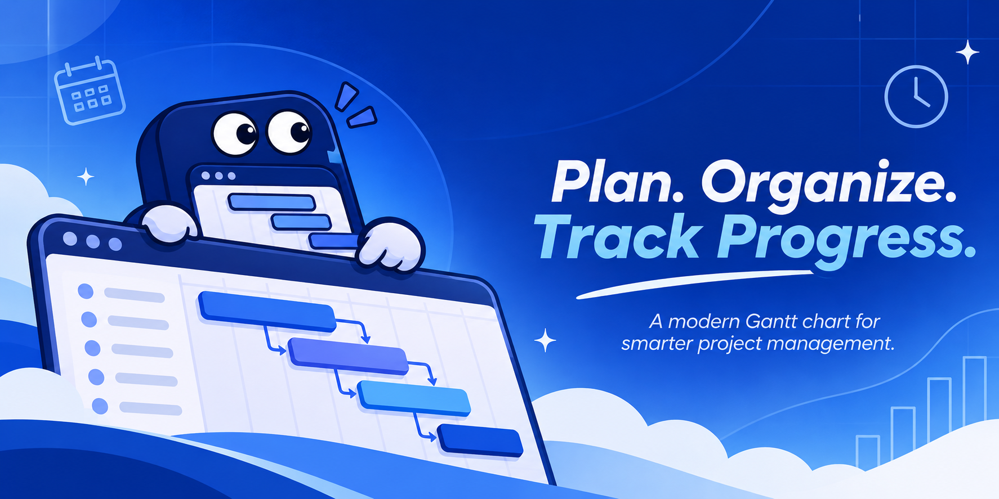

<div align="center">
  
  <h1>Sked</h1>
</div>


<p align="center">
  
</p>

<p align="center">
  <a href="https://skedspace.vercel.app">Live App</a> ·
  <a href="https://skedspace.vercel.app/terms">Terms of Use</a> ·
  <a href="https://skedspace.vercel.app/privacy">Privacy Policy</a> ·
  <a href="./LICENSE">License</a>
</p>

<p align="center">
  
  
  
</p>

## About

Sked is an open-source project workspace for planning Gantt timelines, managing Kanban boards and sortable task lists, tracking project health across workspaces, collaborating live with invited editors, and exporting multi-page charts.

> [!NOTE]
> Open to any Google account with real-time Firebase cloud sync, optional Telegram bot & deadline alerts, and zero ad trackers.

## Features

- **Timeline, Board & List Views:** Switch seamlessly between an interactive Gantt timeline, a 4-column Kanban board, and a sortable task table with inline editing (`1` / `2` / `3` shortcuts, full mobile support).
- **Drag-to-Reschedule, Critical Path & Baselines:** Drag or resize bars directly on the timeline (touch-and-hold on mobile) with automatic dependency cascading, one-click Undo, Critical Path highlighting, and Planned vs. Actual baseline ghost bars.
- **My Focus & Project Health:** Track overdue, due-today, active, and upcoming tasks across all workspaces from one Home dashboard with live `On Track` / `At Risk` / `Off Track` workspace health indicators.
- **Live Sharing & Multi-Editor Collaboration:** Publish live read-only `/share/:shareId` links or invite specific Google accounts as live editors with conflict-safe transactional sync and a dedicated **Shared With Me** section.
- **Nested Tasks & Smart Dependencies:** Organize multi-level phases, tasks, and single-day milestones with automatic parent progress rollups and obstacle-aware dependency arrows.
- **Telegram Bot & Deadline Alerts:** Connect Telegram in one tap for timezone-aware reminders, interactive task browsing (`/tasks`, `/today`, `/upcoming`, `/summary`), and one-tap Mark Done or progress updates synced live.
- **Multi-Page Exports & JSON Import:** Export balanced multi-page PDFs, crisp 2x PNG images, CSV, or JSON, and import `.json` backups with validation.
- **Light & Dark Themes + Full Account Control:** Daylight and dark interfaces with tabbed settings, data export, and permanent account deletion anytime from `Settings -> Profile`.

## Get started

### Prerequisites

- **Node.js 20+** and **npm**
- A free [Firebase](https://console.firebase.google.com) project

### 1. Clone and install

```bash
git clone https://github.com/ByteKen/sked.git
cd sked
npm install
```

### 2. Set up Firebase

1. Open [Firebase Console](https://console.firebase.google.com), create a project, and register a **Web** app.
2. Enable **Authentication -> Sign-in method -> Google**.
3. Create a **Cloud Firestore** database and publish the security rules from [`firestore.rules`](./firestore.rules).
4. Confirm `localhost` is listed under **Authentication -> Settings -> Authorized domains**.

### 3. Add environment variables

Copy [`.env.example`](./.env.example) to `.env.local`:

```bash
cp .env.example .env.local
```

> PowerShell on Windows: `Copy-Item .env.example .env.local`

Paste your Firebase Web app values into the six `VITE_FIREBASE_*` fields:

```env
VITE_FIREBASE_API_KEY=...
VITE_FIREBASE_AUTH_DOMAIN=...
VITE_FIREBASE_PROJECT_ID=...
VITE_FIREBASE_STORAGE_BUCKET=...
VITE_FIREBASE_MESSAGING_SENDER_ID=...
VITE_FIREBASE_APP_ID=...
```

### 4. Start the dev server

```bash
npm run dev
```

Open `http://localhost:5173` in your browser and sign in with Google.

<details>
<summary>Optional: Running Telegram alerts & serverless API routes locally</summary>

1. Create a bot via [@BotFather](https://t.me/BotFather) and generate a Firebase Service Account key under **Project Settings -> Service accounts**.
2. Fill in the server-only variables in `.env.local` (`TELEGRAM_BOT_TOKEN`, `TELEGRAM_BOT_USERNAME`, `TELEGRAM_WEBHOOK_SECRET`, `CRON_SECRET`, `FIREBASE_SERVICE_ACCOUNT_JSON`, and `APP_BASE_URL`). Never prefix these with `VITE_`.
3. Run `npx vercel dev` instead of `npm run dev` to serve both the frontend and `/api/*` endpoints locally.
4. On Vercel production, register your bot webhook once with `/api/telegram/webhook` using your `TELEGRAM_WEBHOOK_SECRET`.

</details>

### Useful scripts

```bash
npm run typecheck  # TypeScript check across app and API
npm run lint       # ESLint check
npm run test       # Run Vitest suite
npm run build      # Production build
```

## License

Licensed under the [Apache License 2.0](./LICENSE) (see [NOTICE](./NOTICE) for attribution).
